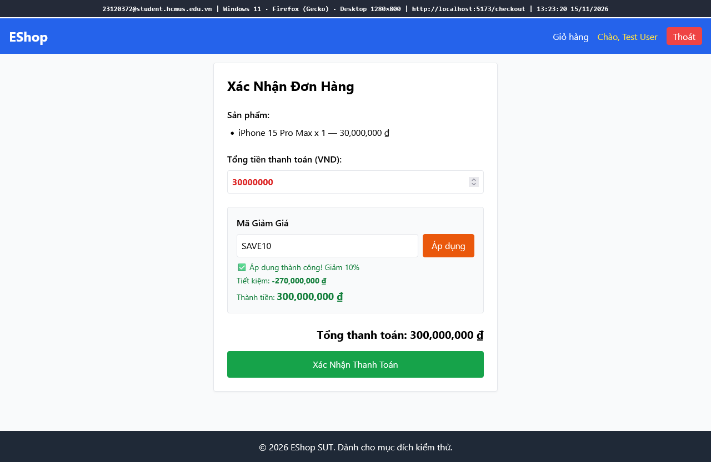

# HW03 — GUI & Usability trên EShop

**Course:** Software Testing (FIT — VNUHCM University of Science)
**Exercise ID:** HW03-AI
**Student:** Phan Trung Tin — **MSSV:** 23120372
**SUT:** EShop — https://github.com/ttbhanh/eshop-sut
**Bloom-AI:** G9.3 (Analyse) + G9.4 (Collaborate with AI for exploratory testing)
**Ngày thực hiện:** 15/11/2026 — …
**Self-assessed grade:** `0__/100`

---

## Mục lục

1. [Phạm vi, môi trường và phương pháp](#1-phạm-vi-môi-trường-và-phương-pháp)
2. [Task 1 — GUI Checklist](#2-task-1--gui-checklist)
3. [Task 2 — Usability Evaluation](#3-task-2--usability-evaluation)
4. [Task 3 — Cross-Browser / Cross-Platform](#4-task-3--cross-browser--cross-platform)
5. [Agent Skills](#5-agent-skills)
6. [AI Audit & AI Critique](#6-ai-audit--ai-critique)
7. [Git commit log](#7-git-commit-log)
8. [Tự đánh giá & bài học](#8-tự-đánh-giá--bài-học)
9. [References](#9-references)

> **Phụ lục:** `Bug_Reports.md` (bug chi tiết) · `AI_Audit_Report.md` (log AI + critique) · `checklist/GUI_Checklist.xlsx` (checklist gốc) · `usability/` (evidence 7 phiên) · `cross-platform/` (3 platform).

---

## 1. Phạm vi, môi trường và phương pháp

### 1.1 Hệ thống dưới kiểm thử (SUT)

| Thành phần | Công nghệ | URL |
| :--- | :--- | :--- |
| Backend API | Node.js + Express + SQLite | http://localhost:3001 |
| Web storefront | React + Vite + Tailwind | http://localhost:5173 |
| Web admin | React + Vite + Tailwind | http://localhost:5174 |
| Mobile app | React Native + Expo | Expo Go (LAN IP) |

> **Ghi chú môi trường:** máy thực hiện có sẵn một ứng dụng Next.js khác chiếm `localhost:3000`, nên SUT được chạy ở API port **3001**. Thay đổi chỉ là port + URL trong frontend (không đổi UI/logic); chi tiết ở `evidence/SUT_LOCAL_PATCH.md`. Mọi screenshot trong bài đều dùng `localhost:3001` (API) và `localhost:5173/5174` (UI).

Tài khoản seed: `test@eshop.com / Test1234!` (user), `admin@eshop.com / Admin123!` (admin).
DB được reset bằng `node database.js` trước mỗi batch execution để kết quả tái lập được.

### 1.2 Phạm vi lựa chọn

**Primary screens cho Task 1:** Giỏ hàng (Cart), Thanh toán (Checkout + coupon), Đăng nhập / Đăng ký (Auth).
**Màn hình phụ (hỗ trợ):** Trang chủ / danh sách sản phẩm, Chi tiết sản phẩm.

Lý do: cụm màn hình này là nơi giao thoa của cả 4 interface aspect (chuẩn chung, form, điều hướng, feedback/state); đồng thời là flow của Task 2 nên evidence dùng lại được, tránh làm hai lần.

**Flow Task 2:** Đăng ký → tìm sản phẩm → thêm vào giỏ → áp mã giảm giá → thanh toán → xem lịch sử đơn hàng.

> Không trùng thành viên nhóm: đã xác nhận với nhóm (không thành viên nào chọn cụm Cart/Checkout/Auth và flow đăng ký → checkout).

### 1.3 Ánh xạ interface aspect ↔ yêu cầu GUI của SUT

SUT không gán FR cho UI, nhưng SRS v2.0 §8 có FR-21…FR-24. Đây là **chuẩn tham chiếu** để checklist có căn cứ, thay vì đánh giá cảm tính.

| IA | Tên | Yêu cầu SUT tương ứng |
| :--- | :--- | :--- |
| IA-01 | General UI standards | FR-21: nhất quán ngôn ngữ/màu/đơn vị tiền, đúng 1 `<h1>`, tab order |
| IA-02 | Forms | FR-22: dấu `*`, `type=email/password`, lỗi trên nút submit, step indicator |
| IA-03 | Navigation | FR-23: navbar highlight, badge giỏ, nhãn "Đăng xuất", breadcrumb |
| IA-04 | Feedback / state | FR-24: toast/badge sau add-to-cart, dialog xác nhận xóa, empty state, alt ảnh |

### 1.4 Phương pháp và cách dùng AI

Quy trình AI-first 4 bước (đóng gói thành skill `skills/gui-checklist-tester`):

1. **Inventory** màn hình → component → state → map IA/FR (AI không được bỏ qua bước này).
2. **Generate** item theo từng IA, có ID + expected + cách kiểm chứng.
3. **Review** của sinh viên: loại item trùng/không test được/sai spec.
4. **Gap-fill**: sinh viên bổ sung item AI bỏ sót, ghi lý do bỏ sót.

Mọi prompt + output + nhận xét + phần sửa của sinh viên được ghi trong `AI_Audit_Report.md` (mỗi artifact 5 mục). Không có kết quả test nào do AI tạo mà không được thực thi thật.

---

## 2. Task 1 — GUI Checklist

### 2.1 Thiết kế checklist

Quy trình 4 bước (đóng gói thành skill `gui-checklist-tester`, chi tiết + prompt đầy đủ ở `checklist/checklist_design.md`):

| Bước | Việc làm | Output |
| :--- | :--- | :--- |
| 1. Inventory | AI đọc DOM 8 route web + admin, liệt kê component/state, map IA; sinh viên xác minh bằng `scripts/inventory.js` | `evidence/inventory.json` |
| 2. Generate | AI sinh item theo 4 IA, mỗi item có Expected + Spec ref + Method | 46 item thô |
| 3. Review | Sinh viên keep/merge/drop/rewrite | còn 41 item AI + 10 quyết định loại bỏ |
| 4. Gap-fill | Sinh viên thêm item AI bỏ sót, ghi lý do | +24 item → **65 item** |

Bộ cuối: **65 item** (ngưỡng đề ≥ 40), phủ **4/4 interface aspect** và **9 màn hình**:

| IA | Tên | Số item | Trọng tâm |
| :--- | :--- | ---: | :--- |
| IA-01 | General UI standards | 16 | heading, `lang`, locale tiền/ngày, alt, contrast, focus, responsive, zoom 200%, dark mode, RTL, touch target |
| IA-02 | Forms | 17 | dấu `*`, input type, label, vị trí + nội dung lỗi, step indicator, giữ dữ liệu, double-submit, quantity, tổng tiền, guest guard, autocomplete, trim, confirm password, hint |
| IA-03 | Navigation | 16 | nav active, badge giỏ, nhãn đăng xuất, breadcrumb, logo, link 404, quay lại mua sắm, route guard, persistence, scroll, exit, admin tab, mobile nav, nhãn icon, back |
| IA-04 | Feedback / state | 16 | toast/badge, first-click, confirm xóa/hủy, empty cart/search, loading, error API, coupon ok/lỗi, nhãn trạng thái đơn, clear cart, XSS, lộ lỗi, submit progress, dismiss |

Phương pháp thực thi: **53 item tự động** (Playwright 1.64.1 + axe-core 4.10.2) và **12 item thủ công** (visual/màu/mobile/browser back), item thủ công có screenshot + số đo computed style.

### 2.2 Item tự bổ sung và lý do AI bỏ sót

24/65 item do sinh viên bổ sung (37%). Lý do được phân thành 4 nhóm (bảng đầy đủ ở sheet `AI vs Human`):

| Nhóm lý do AI bỏ sót | Số item | Ví dụ |
| :--- | ---: | :--- |
| (a) Prompt/scope hẹp — AI chỉ làm đúng màn được nêu | 4 | IA-01-02 (mọi trang), IA-02-15 (trim), IA-03-10 (scroll), IA-04-16 (dismiss) |
| (b) AI thiên về "nhìn thấy", bỏ accessibility/đo lường | 8 | IA-01-03 (`lang`), IA-01-10 (contrast), IA-01-11 (focus), IA-01-13 (zoom), IA-01-16 (touch target), IA-02-04 (label), IA-02-13 (autocomplete), IA-02-14 (placeholder) |
| (c) Bỏ qua người dùng biên / thị trường khác | 3 | IA-01-14 (dark mode), IA-01-15 (RTL), IA-03-14 (nhãn icon) |
| (d) Đặc thù SUT và trạng thái biên | 9 | IA-01-08 (ngày VN), IA-02-09 (double submit), IA-02-17 (hint), IA-03-08 (dead-end), IA-03-09 (persistence), IA-04-02 (first-click), IA-04-07 (error API), IA-04-12 (XSS render), IA-04-13 (lộ lỗi kỹ thuật) |

Ngược lại, **10 item AI sinh bị loại/gộp** vì trùng ý, không đo được hoặc không có trong spec (ví dụ "nút có hover state", "font dễ đọc", "form có nút Reset", "đăng nhập Google/Facebook"). Chi tiết lý do: `checklist/checklist_design.md` §4.

### 2.3 Checklist và kết quả thực thi

| Metric | Value |
| :--- | ---: |
| Item thiết kế | 65 |
| Đã thực thi | 65 (100%) |
| Passed | 21 (32,3%) |
| Failed | 44 (67,7%) |
| Item tự động | 53 |
| Item thủ công | 12 |

| IA | Items | Passed | Failed | Pass rate |
| :--- | ---: | ---: | ---: | ---: |
| IA-01 General UI | 16 | 5 | 11 | 31,3% |
| IA-02 Forms | 17 | 2 | 15 | 11,8% |
| IA-03 Navigation | 16 | 12 | 4 | 75,0% |
| IA-04 Feedback / state | 16 | 2 | 14 | 12,5% |

Nguồn dữ liệu: `evidence/checklist_results.json` (tự động) + `evidence/manual_results.json` (thủ công); bảng đầy đủ + filter trong `checklist/GUI_Checklist.xlsx`; biên bản từng item ở `checklist/execution_log.md`. Screenshot **chỉ cho item Failed**: `screenshots/checklist/*.png` (38 ảnh tự động + 12 ảnh thủ công, trong đó 6 ảnh thủ công thuộc item Passed dùng làm minh chứng quan sát).

**Phát hiện nghiêm trọng nhất** (đối chiếu `Bug_Reports.md`):

1. **Coupon tính sai** — SAVE10 hiển thị "Tiết kiệm −270.000.000 ₫", thành tiền 300.000.000 ₫ cho đơn 30.000.000 ₫ (công thức percent sai ở backend).
2. **Tổng tiền editable** — người dùng sửa được số tiền phải trả trước khi gửi checkout.
3. **Guest vào thẳng /checkout** — tạo được đơn không gắn tài khoản.
4. **XSS qua ô tìm kiếm** — chuỗi `<b>abc</b>` được render thành HTML.
5. **First-click ở Product Detail không thêm vào giỏ** — phải bấm 2 lần.
6. **Mật khẩu Login là `type=text`** — lộ ký tự khi nhập.

### 2.4 Bug phát hiện

44 item Failed được gom thành **34 bug** theo nguyên nhân gốc (một bug có thể phủ nhiều item):

| Severity | Số bug |
| :--- | ---: |
| Blocker | 5 |
| Major | 16 |
| Minor | 12 |
| Cosmetic | 1 |
| **Tổng** | **34** |

Mỗi bug có: steps to reproduce, expected/actual theo spec, impact, screenshot (`screenshots/bugs/GUI-BUG-NN.png`) và **GitHub Issue** tương ứng. Chi tiết: `Bug_Reports.md`; mapping item → bug: `evidence/bug_map.json`.

---

## 3. Task 2 — Usability Evaluation

### 3.1 Mục tiêu

| ID | Mục tiêu | Cách đo |
| :--- | :--- | :--- |
| O1 | Xác định bước gây lạc/do dự nhiều nhất trong flow | Đếm số lần back/đi sai route + thời gian từng bước, ghi quote |
| O2 | Đánh giá khả năng phục hồi khi coupon báo lỗi hoặc giá bất thường | Hành động sau lỗi: tự sửa / hỏi moderator / bỏ qua |
| O3 | Đo hiệu quả tổng thể: task success, thời gian, số lần trợ giúp | Bấm giờ từ lúc đọc scenario đến khi thấy đơn trong lịch sử |
| O4 | Đo mức tin cậy vào đơn hàng và con số thanh toán | Probe trust + có kiểm tra lại tổng tiền không |

### 3.2 Task scenario

Scenario hướng mục tiêu, **không liệt kê bước**, không dùng tên nút (full: `usability/scenario.md`):

> **Bối cảnh:** Bạn vừa chuyển sang dùng một trang bán hàng công nghệ mới. Bạn cần mua một chiếc điện thoại cho công việc và muốn dùng một mã giảm giá bạn được tặng.
>
> **Mục tiêu:** Hãy tạo một tài khoản mới trên trang, tìm một chiếc điện thoại phù hợp, thêm vào giỏ, áp mã giảm giá **SAVE10**, hoàn tất đặt hàng, rồi kiểm tra lại rằng đơn hàng đã được ghi nhận trong tài khoản của bạn.
>
> **Ràng buộc:** ngân sách dưới 50 triệu; mã SAVE10; giao tại nhà; nói to suy nghĩ.

Success criteria: **Success** (không trợ giúp, thấy đơn) · **Success with help** (≥ 1 lần trợ giúp) · **Failure** (> 15 phút hoặc không xác nhận được đơn).

### 3.3 Instruments

| Instrument | Nội dung | File |
| :--- | :--- | :--- |
| Consent | Mục đích, dữ liệu thu, quyền rút, ẩn danh, che 4 số giữa | `usability/consent.md` |
| SUS | 10 câu, thang 5, bản Việt, xen kẽ tích cực/phủ định; công thức chuẩn | `usability/instruments/sus_vi.md` |
| Probe | 12 câu chia 4 nhóm: clarity, error recovery, speed, trust + mở | `usability/instruments/probe_questions.md` |
| Observation sheet | Timeline, friction, quote, số lần trợ giúp, severity 1–4 | `usability/instruments/observation_sheet.md` |
| Moderator script | Câu được phép / không được phép nói, quy tắc 60 giây | `usability/moderator_script.md` |
| Severity | 1 Cosmetic · 2 Minor · 3 Major · 4 Blocker | trong observation sheet |

### 3.4 Tuyển người tham gia & phiên pilot

- **Tiêu chí:** ≥ 18 tuổi, **ngoài lớp HW03**, đã từng mua online trong 6 tháng, không cần biết kiểm thử.
- **Số lượng:** 7 người chính + 1 pilot + 2 dự phòng.
- **Liên hệ:** lưu trong `usability/participants.csv`; khi báo cáo che 4 số giữa (`0901***678`). Bản đầy đủ chỉ gửi TA khi được yêu cầu xác minh.
- **Pilot:** chạy trước với 1 người ngoài 7, mục đích kiểm tra scenario/instruments/thời lượng; dữ liệu pilot **không** tính vào phân tích. Thay đổi sau pilot ghi ở `usability/pilot/pilot_notes.md`.

### 3.5 Bảy phiên

TODO (điền khi có dữ liệu 7 phiên)

### 3.6 Kết quả SUS

TODO (sinh từ `usability/sus_scores.csv` bằng `python scripts/sus_score.py`)

### 3.7 Phân tích theme & severity

TODO

### 3.8 Khuyến nghị

TODO

---

## 4. Task 3 — Cross-Browser / Cross-Platform

### 4.1 Platform đã chạy

Chạy lại **toàn bộ 53 item tự động** của Task 1 trên 4 platform, mỗi platform một browser engine thật (không đổi code SUT, không đổi dữ liệu seed):

| # | ID | Browser / engine | OS / device | Viewport | Loại |
| :-: | :--- | :--- | :--- | :--- | :--- |
| 1 | `windows-chrome` | Chrome 141 — Chromium 141 | Windows 11 | 1280×800 | Desktop (baseline) |
| 2 | `windows-firefox` | Firefox 157 — Gecko | Windows 11 | 1280×800 | Desktop |
| 3 | `windows-webkit` | WebKit 27.2 — engine của Safari | Windows 11 | 1280×800 | Desktop (Safari engine) |
| 4 | `android-chrome` | Chrome Mobile — Chromium 141 | Android 14 · Pixel 7 (Playwright emulation) | 412×915 @2.625x | Mobile |

Công cụ: Playwright 1.64.1 (`scripts/checklist_runner.js` với `BROWSER_KIND`, `PLATFORM_DEVICE`), axe-core 4.10.2, driver `scripts/run_cross_platform.js`. Kết quả thô: `evidence/xplat/results-<platform>.json`; log: `cross-platform/run.log`.

### 4.2 Cách chạy lại

```powershell
$env:PLAYWRIGHT_BROWSERS_PATH = "C:\HCMUS\hk7\Testing\gui-testing-playwright-exercise\.cache\ms-playwright"
node scripts/run_cross_platform.js          # 4 platform: checklist + 4 ảnh màn hình chính
node scripts/build_xplat_matrix.js          # sinh cross-platform/matrix.md + matrix.csv
```

Mỗi platform chạy trong **context riêng** (cookie/localStorage sạch) để tránh lẫn trạng thái; item nào Fail mới chụp screenshot. Ảnh màn hình chính (Home, Login, Cart, Checkout + coupon) chụp trên mọi platform.

### 4.3 Dấu vết trong screenshot

Mọi ảnh Task 3 có overlay cố định ở đầu trang, sinh bằng `scripts/lib/overlay.js`:

```text
23120372@student.hcmus.edu.vn | <Platform label> | <URL localhost> | <dd/mm/yyyy hh:mm:ss>
```

Ví dụ: `23120372@student.hcmus.edu.vn | Android 14 · Chrome Mobile · Pixel 7 (Playwright emulation) | http://localhost:5173/checkout | 15/11/2026 13:23:36`.

Tổng evidence: **38 ảnh item Failed + 4 ảnh màn hình chính cho mỗi platform** (`screenshots/cross-platform/<platform>/`), tất cả full-page và có overlay.

### 4.4 Kết quả

| Platform | Passed | Failed | Pass rate | Khác biệt so với baseline |
| :--- | ---: | ---: | ---: | :--- |
| Windows 11 · Chrome 141 | 15 | 38 | 28,3% | — (baseline) |
| Windows 11 · Firefox 157 | 15 | 38 | 28,3% | 0 |
| Windows 11 · WebKit 27 | 15 | 38 | 28,3% | 0 |
| Android 14 · Pixel 7 | 15 | 38 | 28,3% | 0 |

**0 khác biệt Pass/Fail trên 53 item × 4 platform.** Ma trận đầy đủ: `cross-platform/matrix.md` / `matrix.csv`.

Ảnh dưới là cùng một bước (Checkout + coupon SAVE10) trên 4 platform — cùng một lỗi tính tiền, cùng một bố cục:





Nhận xét theo platform:

| Platform | Quan sát |
| :--- | :--- |
| Chrome 141 | Baseline; layout đúng như mô tả trong Task 1. |
| Firefox 157 | Cùng kích thước full-page (1280×1051 home, 1280×833 các trang còn lại), cùng lỗi; khác biệt duy nhất là font render và scrollbar. |
| WebKit 27 | Cùng kết quả; `alert()`/`confirm()` native hiển thị khác Chromium nhưng luồng không đổi. |
| Android 14 (Pixel 7) | Không có scroll ngang (`scrollWidth = innerWidth`), nhưng bảng giỏ hàng bị bó cột: "Sản phẩm"/"Thành tiền" xuống 3 dòng, nút "Tiến hành thanh toán" bẻ 3 dòng → đọc chậm hơn hẳn desktop (xem `screenshots/cross-platform/android-chrome/03-cart.png`). |

### 4.5 Kết luận Task 3

1. Các lỗi phát hiện ở Task 1 là **lỗi logic/UX của SUT**, không phải lỗi đặc thù một browser — vì tái hiện giống nhau trên 3 engine desktop và 1 mobile.
2. Rủi ro thật của đa nền tảng nằm ở **layout mobile**, không phải JS: control nhỏ hơn 44 px (IA-01-16) và bảng giỏ bị bóp cột. Đây là hai điểm cần ưu tiên nếu SUT mở cho người dùng điện thoại.
3. Giá trị của cross-platform ở bài này là **loại trừ giả thuyết**: không cần điều tra riêng cho Safari/Firefox, nguồn lỗi nằm ở code dùng chung + CSS.

### 4.6 Hạn chế

- `android-chrome` là **emulation** (UA + viewport + touch + DPR), không phải thiết bị thật; iOS/Safari thật và macOS Safari dự kiến bổ sung bằng BrowserStack khi có credentials (script sẽ ghi rõ `browserstack-*`).
- WebKit trên Windows dùng engine Safari nhưng không phải Safari trên macOS — khác biệt font, scrollbar và một số API native có thể chưa lộ ra.
- Chỉ chạy lại 53 item tự động; 12 item thủ công (màu, cảm nhận, back) được kiểm tra trên desktop và ghi ở `checklist/execution_log.md`.
- DB không reset giữa các platform (chỉ đọc/không tạo dữ liệu mới ngoài 1 đơn bị hủy) nên kết quả so sánh được, nhưng không phải môi trường "sạch tuyệt đối".

---

## 5. Agent Skills

### 5.1 Hai skill

| Skill ID | Mục đích | Thành phần |
| :--- | :--- | :--- |
| `gui-checklist-tester` | Ép quy trình thiết kế + thực thi GUI checklist > 40 item phủ IA-01…IA-04, có traceability về FR, chỉ chụp evidence item Failed, xuất bug report | `SKILL.md`, `references/ia-taxonomy.md`, 3 template (checklist row, execution row, bug entry) |
| `usability-evaluation` | Ép quy trình usability test nhỏ: objectives → scenario hướng mục tiêu → instruments → pilot → 7 phiên → phân tích SUS/theme/severity | `SKILL.md`, 6 template (plan, scenario, SUS VI, probe, session notes, participants) |

Cài đặt và demo: `skills/README.md`. Vị trí OpenCode tìm skill: `.opencode/skills/<id>/SKILL.md` (project) hoặc `~/.config/opencode/skills/<id>/SKILL.md` (global).

### 5.2 Vì sao đóng gói thành skill (không chỉ viết prompt)

1. **Tái sử dụng**: lần sau chỉ cần `@skill-gui-checklist-tester` thay vì dán lại 3 đoạn prompt dài; template đi kèm được load đúng lúc.
2. **Ép quy trình có thứ tự**: skill cấm sinh item trước khi có inventory; cấm chạy usability trước khi có objectives + pilot. Đây là các bước AI thường bỏ qua nếu chỉ prompt tự do.
3. **Guardrail chống bịa**: skill ghi rõ "không bịa kết quả", "item chưa chạy ghi Not executed", "notes của item Failed phải nêu nguyên nhân quan sát được", "không tự tạo participant".
4. **Có tiêu chuẩn đầu ra**: mỗi item bắt buộc có `ID | Aspect | Screen | Expected | Spec ref | Method | Priority`; mỗi phiên usability có `notes/SUS/probe/timeline`.

### 5.3 Bằng chứng skill được dùng thật trong bài này

- Bộ 65 item sinh theo đúng 4 bước của skill (inventory → generate → review → gap-fill), review log 10 quyết định và 24 item gap-fill nằm trong `checklist/checklist_design.md`.
- 12 item thủ công + 53 item tự động đúng quy ước `Method` của skill; screenshot chỉ cho item Failed.
- Bộ instrument usability (scenario không liệt kê bước, consent, SUS VI, probe 4 nhóm, phiên pilot) được tạo từ template của skill, không phải viết lại từ đầu.
- Video demo: TODO (link YouTube unlisted) — kịch bản quay ở `skills/README.md`.

### 5.4 Giới hạn của skill

- Skill không thay thế người tham gia thật hay việc chạy test; nó chỉ chuẩn hoá quy trình và output.
- Skill không tự quyết severity/theme — phần này vẫn do sinh viên đọc evidence và quyết định.
- Nếu SUT khác hoàn toàn (mobile native, không có DOM), `references/ia-taxonomy.md` cần chỉnh trước khi dùng.

---

## 6. AI Audit & AI Critique

### 6.1 AI Audit

Log đầy đủ theo từng artifact (prompt → output → verdict → reasoning → student fix) nằm trong `AI_Audit_Report.md`:

| Artifact | Nội dung | Verdict |
| :--- | :--- | :--- |
| 0 | Đọc đề, inventory SUT, lập kế hoạch 9 giai đoạn | Partially valid — phải tách automated/manual, không tin giả thuyết lỗi từ code |
| 1 | Sinh 46 item, phát hiện gap, viết runner Playwright | Partially valid — 5 item không đo được, runner có 2 false positive phải sửa |
| 2 | Gom 44 item Failed thành 34 bug, viết bug report | Valid with correction — nâng coupon lên Blocker, giữ mapping item → bug |

### 6.2 AI Critique (200–300 từ)

AI giúp tôi đi nhanh ở phần **mở rộng phạm vi**: nó đọc 8 route, liệt kê component/state và sinh 46 item chỉ trong vài phút — việc tôi tự làm sẽ mất ít nhất một buổi và dễ bỏ sót màn hình. Tuy nhiên, giá trị thật của bài không nằm ở số lượng item AI sinh, mà ở chỗ tôi phát hiện **AI tự tin sai**. Ba biểu hiện rõ nhất: (1) AI mô tả lỗi như thể đã kiểm chứng khi mới đọc source (login `type=text`, Home 2 `<h1>`), trong khi đề yêu cầu bằng chứng thực thi; (2) AI sinh item "chuẩn chung" nhưng bỏ trống nhóm người dùng biên — persistence, dead-end, XSS-render, lộ lỗi kỹ thuật — tức là những lỗi chỉ lộ khi dùng thật; (3) runner do AI viết có false positive vì dùng `page.goto()` làm mất React state. Nếu tôi tin AI 100%, báo cáo sẽ vừa thừa item không đo được, vừa bỏ lỗi nghiêm trọng, vừa sai kết quả.

Điều thú vị là AI có ích nhất khi bị **bắt tự phản biện**: prompt "chỉ ra 10 nhóm còn thiếu" giúp lộ 6 nhóm, tôi bổ sung 4 nhóm còn lại. Điều này cho thấy vai trò con người là đặt câu hỏi và kiểm chứng, không phải duyệt output. Với usability, AI chỉ tạo được khung; 7 người thật mới là nguồn dữ liệu không thể thay thế, vì AI không thể "bối rối" hay "mất niềm tin" như người dùng.

Kết luận: AI là **leverage**, không phải **authority**. Quy tắc tôi giữ là: mọi kết quả phải có evidence chạy lại được; mọi item AI sinh phải qua review; mọi bug phải có screenshot và bước tái hiện.

---

## 7. Git commit log

TODO

---

## 8. Tự đánh giá & bài học

TODO

---

## 9. References

- ISTQB Foundation Level Syllabus (latest edition).
- SRS EShop v2.0 — https://github.com/ttbhanh/eshop-sut
- WCAG 2.2 Quick Reference — https://www.w3.org/WAI/WCAG22/quickref/
- Nielsen Norman Group — Usability Testing 101.
- Brooke, J. (1996). SUS: A "quick and dirty" usability scale.
- Hardman, P. (2025). A Post-AI Learning Taxonomy.
- Anthropic (2025). Building Reliable AI Test Agents.
