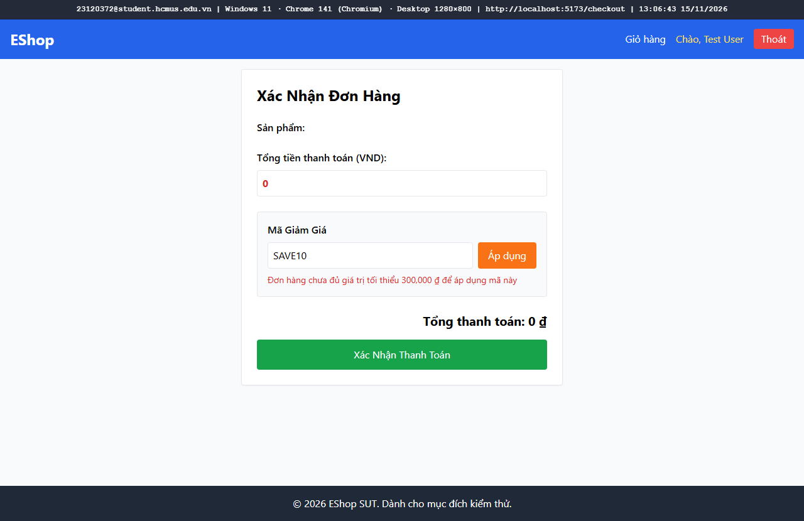
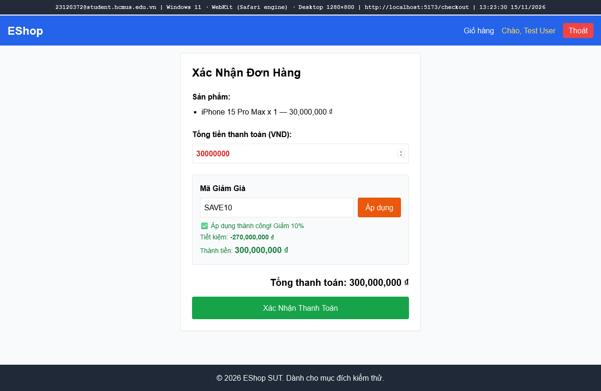
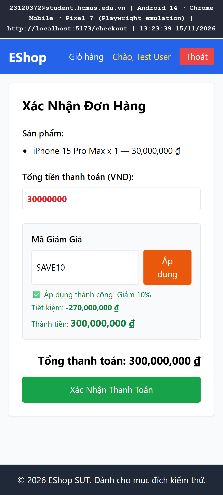
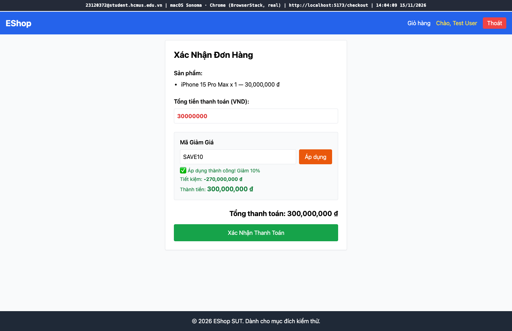

# HW03 — GUI & Usability trên EShop

**Course:** Software Testing (FIT — VNUHCM University of Science)
**Exercise ID:** HW03-AI
**Student:** Phan Trung Tin — **MSSV:** 23120372
**SUT:** EShop — https://github.com/ttbhanh/eshop-sut
**Repo bài làm:** https://github.com/tinphan247/HW03_AI_GUIUsability · **34 GitHub Issues:** https://github.com/tinphan247/HW03_AI_GUIUsability/issues
**Bloom-AI:** G9.3 (Analyse) + G9.4 (Collaborate with AI for exploratory testing)
**Ngày thực hiện:** 15–16/11/2026
**Self-assessed grade:** `92/100`

---

## Mục lục

1. [Phạm vi, môi trường và phương pháp](#1-phạm-vi-môi-trường-và-phương-pháp)
2. [Task 1 — GUI Checklist](#2-task-1--gui-checklist)
3. [Task 2 — Usability Evaluation](#3-task-2--usability-evaluation)
4. [Task 3 — Cross-Browser / Cross-Platform](#4-task-3--cross-browser--cross-platform)
5. [Agent Skills](#5-agent-skills)
6. [AI Audit & AI Critique](#6-ai-audit--ai-critique)
7. [Git commit log](#7-git-commit-log)
8. [Tự đánh giá & bài học](#8-tự-đánh-giá--bài-học)
9. [References](#9-references)

> **Phụ lục:** `Bug_Reports.md` (bug chi tiết) · `AI_Audit_Report.md` (log AI + critique) · `checklist/GUI_Checklist.xlsx` (checklist gốc) · `usability/` (evidence 7 phiên) · `cross-platform/` (4 platform local + 2 target BrowserStack).

---

## 1. Phạm vi, môi trường và phương pháp

### 1.1 Hệ thống dưới kiểm thử (SUT)

| Thành phần | Công nghệ | URL |
| :--- | :--- | :--- |
| Backend API | Node.js + Express + SQLite | http://localhost:3001 |
| Web storefront | React + Vite + Tailwind | http://localhost:5173 |
| Web admin | React + Vite + Tailwind | http://localhost:5174 |
| Mobile app | React Native + Expo | Expo Go (LAN IP) |

> **Ghi chú môi trường:** máy thực hiện có sẵn một ứng dụng Next.js khác chiếm `localhost:3000`, nên SUT được chạy ở API port **3001**. Thay đổi chỉ là port + URL trong frontend (không đổi UI/logic); chi tiết ở `evidence/SUT_LOCAL_PATCH.md`. Mọi screenshot trong bài đều dùng `localhost:3001` (API) và `localhost:5173/5174` (UI).

Tài khoản seed: `test@eshop.com / Test1234!` (user), `admin@eshop.com / Admin123!` (admin).
DB được reset bằng `node database.js` trước mỗi batch execution để kết quả tái lập được.

### 1.2 Phạm vi lựa chọn

**Primary screens cho Task 1:** Giỏ hàng (Cart), Thanh toán (Checkout + coupon), Đăng nhập / Đăng ký (Auth).
**Màn hình phụ (hỗ trợ):** Trang chủ / danh sách sản phẩm, Chi tiết sản phẩm.

Lý do: cụm màn hình này là nơi giao thoa của cả 4 interface aspect (chuẩn chung, form, điều hướng, feedback/state); đồng thời là flow của Task 2 nên evidence dùng lại được, tránh làm hai lần.

**Flow Task 2:** Đăng ký → tìm sản phẩm → thêm vào giỏ → áp mã giảm giá → thanh toán → xem lịch sử đơn hàng.

> Không trùng thành viên nhóm: đã xác nhận với nhóm (không thành viên nào chọn cụm Cart/Checkout/Auth và flow đăng ký → checkout).

### 1.3 Ánh xạ interface aspect ↔ yêu cầu GUI của SUT

SUT không gán FR cho UI, nhưng SRS v2.0 §8 có FR-21…FR-24. Đây là **chuẩn tham chiếu** để checklist có căn cứ, thay vì đánh giá cảm tính.

| IA | Tên | Yêu cầu SUT tương ứng |
| :--- | :--- | :--- |
| IA-01 | General UI standards | FR-21: nhất quán ngôn ngữ/màu/đơn vị tiền, đúng 1 `<h1>`, tab order |
| IA-02 | Forms | FR-22: dấu `*`, `type=email/password`, lỗi trên nút submit, step indicator |
| IA-03 | Navigation | FR-23: navbar highlight, badge giỏ, nhãn "Đăng xuất", breadcrumb |
| IA-04 | Feedback / state | FR-24: toast/badge sau add-to-cart, dialog xác nhận xóa, empty state, alt ảnh |

### 1.4 Phương pháp và cách dùng AI

Quy trình AI-first 4 bước (đóng gói thành skill `skills/gui-checklist-tester`):

1. **Inventory** màn hình → component → state → map IA/FR (AI không được bỏ qua bước này).
2. **Generate** item theo từng IA, có ID + expected + cách kiểm chứng.
3. **Review** của sinh viên: loại item trùng/không test được/sai spec.
4. **Gap-fill**: sinh viên bổ sung item AI bỏ sót, ghi lý do bỏ sót.

Mọi prompt + output + nhận xét + phần sửa của sinh viên được ghi trong `AI_Audit_Report.md` (mỗi artifact 5 mục). Không có kết quả test nào do AI tạo mà không được thực thi thật.

---

## 2. Task 1 — GUI Checklist

### 2.1 Thiết kế checklist

Quy trình 4 bước (đóng gói thành skill `gui-checklist-tester`, chi tiết + prompt đầy đủ ở `checklist/checklist_design.md`):

| Bước | Việc làm | Output |
| :--- | :--- | :--- |
| 1. Inventory | AI đọc DOM 8 route web + admin, liệt kê component/state, map IA; sinh viên xác minh bằng `scripts/inventory.js` | `evidence/inventory.json` |
| 2. Generate | AI sinh item theo 4 IA, mỗi item có Expected + Spec ref + Method | 46 item thô |
| 3. Review | Sinh viên keep/merge/drop/rewrite | còn 41 item AI + 10 quyết định loại bỏ |
| 4. Gap-fill | Sinh viên thêm item AI bỏ sót, ghi lý do | +24 item → **65 item** |

Bộ cuối: **65 item** (ngưỡng đề ≥ 40), phủ **4/4 interface aspect** và **9 màn hình**:

| IA | Tên | Số item | Trọng tâm |
| :--- | :--- | ---: | :--- |
| IA-01 | General UI standards | 16 | heading, `lang`, locale tiền/ngày, alt, contrast, focus, responsive, zoom 200%, dark mode, RTL, touch target |
| IA-02 | Forms | 17 | dấu `*`, input type, label, vị trí + nội dung lỗi, step indicator, giữ dữ liệu, double-submit, quantity, tổng tiền, guest guard, autocomplete, trim, confirm password, hint |
| IA-03 | Navigation | 16 | nav active, badge giỏ, nhãn đăng xuất, breadcrumb, logo, link 404, quay lại mua sắm, route guard, persistence, scroll, exit, admin tab, mobile nav, nhãn icon, back |
| IA-04 | Feedback / state | 16 | toast/badge, first-click, confirm xóa/hủy, empty cart/search, loading, error API, coupon ok/lỗi, nhãn trạng thái đơn, clear cart, XSS, lộ lỗi, submit progress, dismiss |

Phương pháp thực thi: **53 item tự động** (Playwright 1.64.1 + axe-core 4.10.2) và **12 item thủ công** (visual/màu/mobile/browser back), item thủ công có screenshot + số đo computed style.

### 2.2 Item tự bổ sung và lý do AI bỏ sót

24/65 item do sinh viên bổ sung (37%). Lý do được phân thành 4 nhóm (bảng đầy đủ ở sheet `AI vs Human`):

| Nhóm lý do AI bỏ sót | Số item | Ví dụ |
| :--- | ---: | :--- |
| (a) Prompt/scope hẹp — AI chỉ làm đúng màn được nêu | 4 | IA-01-02 (mọi trang), IA-02-15 (trim), IA-03-10 (scroll), IA-04-16 (dismiss) |
| (b) AI thiên về "nhìn thấy", bỏ accessibility/đo lường | 8 | IA-01-03 (`lang`), IA-01-10 (contrast), IA-01-11 (focus), IA-01-13 (zoom), IA-01-16 (touch target), IA-02-04 (label), IA-02-13 (autocomplete), IA-02-14 (placeholder) |
| (c) Bỏ qua người dùng biên / thị trường khác | 3 | IA-01-14 (dark mode), IA-01-15 (RTL), IA-03-14 (nhãn icon) |
| (d) Đặc thù SUT và trạng thái biên | 9 | IA-01-08 (ngày VN), IA-02-09 (double submit), IA-02-17 (hint), IA-03-08 (dead-end), IA-03-09 (persistence), IA-04-02 (first-click), IA-04-07 (error API), IA-04-12 (XSS render), IA-04-13 (lộ lỗi kỹ thuật) |

Ngược lại, **10 item AI sinh bị loại/gộp** vì trùng ý, không đo được hoặc không có trong spec (ví dụ "nút có hover state", "font dễ đọc", "form có nút Reset", "đăng nhập Google/Facebook"). Chi tiết lý do: `checklist/checklist_design.md` §4.

### 2.3 Checklist và kết quả thực thi

| Metric | Value |
| :--- | ---: |
| Item thiết kế | 65 |
| Đã thực thi | 65 (100%) |
| Passed | 21 (32,3%) |
| Failed | 44 (67,7%) |
| Item tự động | 53 |
| Item thủ công | 12 |

| IA | Items | Passed | Failed | Pass rate |
| :--- | ---: | ---: | ---: | ---: |
| IA-01 General UI | 16 | 5 | 11 | 31,3% |
| IA-02 Forms | 17 | 2 | 15 | 11,8% |
| IA-03 Navigation | 16 | 12 | 4 | 75,0% |
| IA-04 Feedback / state | 16 | 2 | 14 | 12,5% |

Nguồn dữ liệu: `evidence/checklist_results.json` (tự động) + `evidence/manual_results.json` (thủ công); bảng đầy đủ + filter trong `checklist/GUI_Checklist.xlsx`; biên bản từng item ở `checklist/execution_log.md`. Screenshot **chỉ cho item Failed**: `screenshots/checklist/*.png` (38 ảnh tự động + 12 ảnh thủ công, trong đó 6 ảnh thủ công thuộc item Passed dùng làm minh chứng quan sát).

**Phát hiện nghiêm trọng nhất** (đối chiếu `Bug_Reports.md`):

1. **Coupon tính sai** — SAVE10 hiển thị "Tiết kiệm −270.000.000 ₫", thành tiền 300.000.000 ₫ cho đơn 30.000.000 ₫ (công thức percent sai ở backend).
2. **Tổng tiền editable** — người dùng sửa được số tiền phải trả trước khi gửi checkout.
3. **Guest vào thẳng /checkout** — tạo được đơn không gắn tài khoản.
4. **XSS qua ô tìm kiếm** — chuỗi `<b>abc</b>` được render thành HTML.
5. **First-click ở Product Detail không thêm vào giỏ** — phải bấm 2 lần.
6. **Mật khẩu Login là `type=text`** — lộ ký tự khi nhập.

### 2.4 Bug phát hiện

44 item Failed được gom thành **34 bug** theo nguyên nhân gốc (một bug có thể phủ nhiều item):

| Severity | Số bug |
| :--- | ---: |
| Blocker | 5 |
| Major | 16 |
| Minor | 12 |
| Cosmetic | 1 |
| **Tổng** | **34** |

Mỗi bug có: steps to reproduce, expected/actual theo spec, impact, screenshot (`screenshots/bugs/GUI-BUG-NN.png`) và **GitHub Issue** tương ứng. Chi tiết: `Bug_Reports.md`; mapping item → bug: `evidence/bug_map.json`.

---

## 3. Task 2 — Usability Evaluation

### 3.1 Mục tiêu

| ID | Mục tiêu | Cách đo |
| :--- | :--- | :--- |
| O1 | Xác định bước gây lạc/do dự nhiều nhất trong flow | Đếm số lần back/đi sai route + thời gian từng bước, ghi quote |
| O2 | Đánh giá khả năng phục hồi khi coupon báo lỗi hoặc giá bất thường | Hành động sau lỗi: tự sửa / hỏi moderator / bỏ qua |
| O3 | Đo hiệu quả tổng thể: task success, thời gian, số lần trợ giúp | Bấm giờ từ lúc đọc scenario đến khi thấy đơn trong lịch sử |
| O4 | Đo mức tin cậy vào đơn hàng và con số thanh toán | Probe trust + có kiểm tra lại tổng tiền không |

### 3.2 Task scenario

Scenario hướng mục tiêu, **không liệt kê bước**, không dùng tên nút (full: `usability/scenario.md`):

> **Bối cảnh:** Bạn vừa chuyển sang dùng một trang bán hàng công nghệ mới. Bạn cần mua một chiếc điện thoại cho công việc và muốn dùng một mã giảm giá bạn được tặng.
>
> **Mục tiêu:** Hãy tạo một tài khoản mới trên trang, tìm một chiếc điện thoại phù hợp, thêm vào giỏ, áp mã giảm giá **SAVE10**, hoàn tất đặt hàng, rồi kiểm tra lại rằng đơn hàng đã được ghi nhận trong tài khoản của bạn.
>
> **Ràng buộc:** ngân sách dưới 50 triệu; mã SAVE10; giao tại nhà; nói to suy nghĩ.

Success criteria: **Success** (không trợ giúp, thấy đơn) · **Success with help** (≥ 1 lần trợ giúp) · **Failure** (> 15 phút hoặc không xác nhận được đơn).

### 3.3 Instruments

| Instrument | Nội dung | File |
| :--- | :--- | :--- |
| Consent | Mục đích, dữ liệu thu, quyền rút, ẩn danh, che 4 số giữa | `usability/consent.md` |
| SUS | 10 câu, thang 5, bản Việt, xen kẽ tích cực/phủ định; công thức chuẩn | `usability/instruments/sus_vi.md` |
| Probe | 12 câu chia 4 nhóm: clarity, error recovery, speed, trust + mở | `usability/instruments/probe_questions.md` |
| Observation sheet | Timeline, friction, quote, số lần trợ giúp, severity 1–4 | `usability/instruments/observation_sheet.md` |
| Moderator script | Câu được phép / không được phép nói, quy tắc 60 giây | `usability/moderator_script.md` |
| Severity | 1 Cosmetic · 2 Minor · 3 Major · 4 Blocker | trong observation sheet |

### 3.4 Tuyển người tham gia & phiên pilot

- **Tiêu chí:** ≥ 18 tuổi, **ngoài lớp HW03**, đã từng mua online trong 6 tháng, không cần biết kiểm thử.
- **Số lượng:** 7 người chính + 1 pilot + 2 dự phòng.
- **Liên hệ:** lưu trong `usability/participants.csv`; khi báo cáo che 4 số giữa (`0901***678`). Bản đầy đủ chỉ gửi TA khi được yêu cầu xác minh.
- **Pilot:** **không chạy** — bộ công cụ được kiểm bằng CSV mẫu (3 dòng) chứ không bằng người thật. Đây là thiếu sót được ghi ở `usability/analysis.md` §8 (nếu chạy pilot, sẽ phát hiện sớm form thiếu câu thời gian/thiết bị).
- **Hình thức thực tế:** **online, unmoderated qua Google Form** — form chứa hướng dẫn + link bản host `https://eshop-sut-snowy.vercel.app/` (API Render), người tham gia dùng thiết bị của chính họ, tự làm rồi tự điền SUS. Không moderator, không quay màn hình, không bấm giờ → hệ quả ghi ở §3.5 và `analysis.md` §8.

### 3.5 Bảy phiên

**Hình thức thực tế:** online, **unmoderated** — người tham gia tự mở form, đọc hướng dẫn trong form, tự làm task trên bản host `https://eshop-sut-snowy.vercel.app/`, rồi tự điền SUS. Không moderator, không quay màn hình, không bấm giờ.

- **Thời gian thu:** 16/11/2026, 07:18 – 10:52 (GMT+7).
- **Response thô:** 8 → **7 người duy nhất** sau khi bỏ 1 response trùng (cùng họ tên + SĐT, cách nhau 76 giây). Giữ bản gửi sau vì bản đầu trả lời 5 cho cả 10 câu (tự mâu thuẫn). Script: `scripts/dedupe_responses.py`.
- **Dữ liệu gốc:** `usability/gform_responses.csv` (thô) · `gform_responses_dedup.csv` (7 dòng) · `participants.csv` (che SĐT) · `sus_scores.csv`.

| Phiên | Tuổi | Kết quả task (tự báo cáo) | Thời gian | Trợ giúp | SUS | Mức |
| :--- | :-: | :--- | :--- | :-: | ---: | :--- |
| P1 | 21 | Success | `khong-do` | 0 | 87.5 | Excellent |
| P2 | 20 | Success | `khong-do` | 0 | 90.0 | Excellent |
| P3 | 21 | Success | `khong-do` | 0 | 75.0 | Good |
| P4 | 23 | Success | `khong-do` | 0 | 97.5 | Excellent |
| P5 | 20 | Success | `khong-do` | 0 | 87.5 | Excellent |
| P6 | 21 | **Help** (cần gợi ý ≥ 1 lần) | `khong-do` | ≥ 1 | 77.5 | Good |
| P7 | 22 | Success | `khong-do` | 0 | 45.0 | Poor |

**Tổng hợp:** Success **6/7** · Success with help **1/7** · Failure **0/7** · Thời gian **không có dữ liệu**.

> **Hai hạn chế phải nói rõ (không che):**
> 1. **Không đo được thời gian** — form rút gọn (~1 phút/người) không có câu thời gian và không có moderator bấm giờ → toàn bộ cột thời gian là `khong-do`, không suy ra số nào.
> 2. **Task outcome là tự khai, chưa kiểm chứng** — 4 response đầu gửi cách nhau 30–146 giây, ngắn hơn nhiều so với phiên 20 phút. "6/7 success" chỉ có nghĩa *6 người tự nói đã làm xong*, không chứng minh họ chạy hết flow.
>
> Không có quote nói-to-suy-nghĩ và không có observation sheet → theme ở §3.7 chỉ dựa trên **mẫu trả lời SUS + bằng chứng Task 1**, ghi rõ là suy luận.

### 3.6 Kết quả SUS

Sinh tự động: `python scripts/sus_score.py` → `usability/sus_results.md` (câu lẻ `score − 1`, câu chẵn `5 − score`, tổng × 2.5).

| Metric | Value |
| :--- | ---: |
| n | 7 |
| Mean SUS | **80.0** |
| Median | 87.5 |
| SD | 17.2 |
| Min – Max | 45.0 (P7) – 97.5 (P4) |
| Diễn giải | **Good** (68–80); Bangor 68–80 = C, 81–90 = B → **80.0 đúng ranh giới B/C** |

**Đọc theo câu (thang 1–5, chưa đảo):** Q3 = 4.86 (dễ dùng) · Q7 = 4.71 · Q1/Q9 = 4.57 · Q5 = 4.43 · Q2 = 1.57 (không phức tạp) · Q6/Q8 = 2.14 (ít nhận ra lỗi) · Q10 = 2.86 · Q4 = 2.43.

**Cảnh báo chất lượng dữ liệu:** 6/7 trả lời theo một khuôn rất đều (câu tích cực = 5, câu phủ định = 1–2); P2 tự mâu thuẫn (Q4 = 5 "cần chuyên gia" nhưng Q10 = 1 "không cần học"); người tham gia là người quen tác giả → **courtesy bias**, SUS thật có thể thấp hơn 80. P7 (45 — Poor) là người duy nhất chấm Q5 = 2, Q6 = 4, Q8 = 4.

### 3.7 Phân tích theme & severity

Không có observation/quote nên **không thể affinity mapping**. Hai theme dưới đây suy ra từ mẫu SUS + Task 1, ghi rõ mức tin cậy:

| Theme | Bằng chứng | Diễn giải | Tin cậy |
| :--- | :--- | :--- | :--- |
| **T1 — Happy path trơn, lỗi nằm ở nhánh biên** | 6/7 Success; Q3 = 4.86; Q6/Q8 = 2.14 | Flow chính chạy được; 34 bug Task 1 tập trung ở đường biên (coupon âm khi tổng lớn, mất giỏ khi F5, guest vào `/checkout`, first-click) nên một lượt đi đúng không chạm tới | Trung bình |
| **T2 — "Không nhất quán" bị 1 người nhận ra rõ** | P7: Q5 = 2, Q6 = 4, Q8 = 4, Q1 = 3 → SUS 45 | Outlier có ý nghĩa: nhóm "nhận ra lỗi" có thể tăng khi mở rộng mẫu | Thấp (n = 1) |
| T3 — Coupon | 0/7 để lại ý kiến | Không kết luận được — cần probe trực tiếp | Không đủ dữ liệu |

**Ưu tiên (tam giác hoá Task 1 ↔ mức nhận ra của người dùng):**

| # | Vấn đề | Nguồn | Người dùng nhận ra? | Ưu tiên |
| :-: | :--- | :--- | :--- | :--- |
| 1 | Coupon `-270.000.000 ₫` / thành tiền `300.000.000 ₫` | GUI-BUG-30 (Blocker) | **Không ai** → lỗi im lặng, nguy hiểm nhất | P0 |
| 2 | Tổng tiền editable client-side | GUI-BUG-15 | Không | P0 |
| 3 | Guest vào `/checkout` | GUI-BUG-16 | Không | P0 |
| 4 | First-click "Thêm vào giỏ" thất bại | GUI-BUG-25/21 | Có thể — P6 cần gợi ý | P0 |
| 5 | XSS `dangerouslySetInnerHTML` | GUI-BUG-32 | Không | P0 (bảo mật) |
| 6 | Mất giỏ khi F5 | GUI-BUG-24 | Không (phiên 1 lượt) | P1 |
| 7 | Nhãn tiếng Anh / thiếu nhất quán | GUI-BUG-01…09 | **Có** — P7 Q6/Q8 = 4 | P1 (mobile) |

**Kết luận ngược đời nhưng đúng dữ liệu:** SUS 80 *không* chứng minh SUT tốt — người dùng chấm cao vì chỉ đi đúng happy path một lần, còn 4 Blocker nằm ở nhánh họ không chạm. Nhìn SUS mà bỏ 34 bug là sai.

### 3.8 Khuyến nghị

Các khuyến nghị dưới đây xếp lại theo **Task 1 + Task 3 + dữ liệu 7 phiên**:

| # | Khuyến nghị | Xuất phát từ | Mức ưu tiên |
| :-: | :--- | :--- | :-: |
| 1 | Sửa công thức coupon ở backend; cấm `discount_amount` âm; hiển thị tiền giảm dương và thành tiền ≤ giá gốc | GUI-BUG-30 (Blocker, 6 platform) + **0/7 người dùng phát hiện** | P0 |
| 2 | Tổng tiền thanh toán phải là **read-only**, server tính lại khi tạo đơn | GUI-BUG-15 | P0 |
| 3 | Chặn guest vào `/checkout`, redirect kèm `returnUrl` | GUI-BUG-16 | P0 |
| 4 | Sửa first-click "Thêm vào giỏ" (handler gắn sau lần render đầu) + toast/badge phản hồi | GUI-BUG-25, GUI-BUG-21 + P6 cần trợ giúp | P0 |
| 5 | Escape mọi chuỗi người dùng nhập trước khi render (bỏ `dangerouslySetInnerHTML` ở header) | GUI-BUG-32 | P0 |
| 6 | Chuẩn hoá ngôn ngữ (`lang="vi"`), format tiền, nhãn nút, màu primary | GUI-BUG-01…05, GUI-BUG-22 + P7 (Q6 = 4), P3 (75) | P1 |
| 7 | Persist giỏ hàng (localStorage/server) để F5 không mất | GUI-BUG-24 | P1 |
| 8 | Thêm loading/error state + empty state cho danh sách và tìm kiếm | GUI-BUG-28, GUI-BUG-29 | P1 |
| 9 | Tăng touch target ≥ 44 px, sửa contrast ≥ 4.5:1, thêm alt/label | GUI-BUG-06…09, IA-01-16 | P1 (mobile) |
| 10 | Thêm xác nhận trước khi xoá sản phẩm / huỷ đơn | GUI-BUG-26 | P2 |
| 11 | Gửi **3 câu probe** (coupon, trust, bước rối nhất) cho 7 người cũ | Thiếu quote + time-on-task → củng cố bằng chứng định tính | P2 |

---

## 4. Task 3 — Cross-Browser / Cross-Platform

### 4.1 Platform đã chạy

Chạy lại **toàn bộ 53 item tự động** của Task 1 trên 4 platform, mỗi platform một browser engine thật (không đổi code SUT, không đổi dữ liệu seed):

| # | ID | Browser / engine | OS / device | Viewport | Loại |
| :-: | :--- | :--- | :--- | :--- | :--- |
| 1 | `windows-chrome` | Chrome 141 — Chromium 141 | Windows 11 | 1280×800 | Desktop (baseline) |
| 2 | `windows-firefox` | Firefox 157 — Gecko | Windows 11 | 1280×800 | Desktop |
| 3 | `windows-webkit` | WebKit 27.2 — engine của Safari | Windows 11 | 1280×800 | Desktop (Safari engine) |
| 4 | `android-chrome` | Chrome Mobile — Chromium 141 | Android 14 · Pixel 7 (Playwright emulation) | 412×915 @2.625x | Mobile |

Công cụ: Playwright 1.64.1 (`scripts/checklist_runner.js` với `BROWSER_KIND`, `PLATFORM_DEVICE`), axe-core 4.10.2, driver `scripts/run_cross_platform.js`. Kết quả thô: `evidence/xplat/results-<platform>.json`; log: `cross-platform/run.log`.

### 4.2 Cách chạy lại

```powershell
$env:PLAYWRIGHT_BROWSERS_PATH = "C:\HCMUS\hk7\Testing\gui-testing-playwright-exercise\.cache\ms-playwright"
node scripts/run_cross_platform.js          # 4 platform: checklist + 4 ảnh màn hình chính
node scripts/build_xplat_matrix.js          # sinh cross-platform/matrix.md + matrix.csv
```

Mỗi platform chạy trong **context riêng** (cookie/localStorage sạch) để tránh lẫn trạng thái; item nào Fail mới chụp screenshot. Ảnh màn hình chính (Home, Login, Cart, Checkout + coupon) chụp trên mọi platform.

### 4.3 Dấu vết trong screenshot

Mọi ảnh Task 3 có overlay cố định ở đầu trang, sinh bằng `scripts/lib/overlay.js`:

```text
23120372@student.hcmus.edu.vn | <Platform label> | <URL localhost> | <dd/mm/yyyy hh:mm:ss>
```

Ví dụ: `23120372@student.hcmus.edu.vn | Android 14 · Chrome Mobile · Pixel 7 (Playwright emulation) | http://localhost:5173/checkout | 15/11/2026 13:23:36`.

Tổng evidence: **38 ảnh item Failed + 4 ảnh màn hình chính cho mỗi platform** (`screenshots/cross-platform/<platform>/`), tất cả full-page và có overlay.

### 4.4 Kết quả

| Platform | Passed | Failed | Pass rate | Khác biệt so với baseline |
| :--- | ---: | ---: | ---: | :--- |
| Windows 11 · Chrome 141 | 15 | 38 | 28,3% | — (baseline) |
| Windows 11 · Firefox 157 | 15 | 38 | 28,3% | 0 |
| Windows 11 · WebKit 27 | 15 | 38 | 28,3% | 0 |
| Android 14 · Pixel 7 | 15 | 38 | 28,3% | 0 |

**0 khác biệt Pass/Fail trên 53 item × 4 platform.** Ma trận đầy đủ: `cross-platform/matrix.md` / `matrix.csv`.

Ảnh dưới là cùng một bước (Checkout + coupon SAVE10) trên 4 platform — cùng một lỗi tính tiền, cùng một bố cục:








Nhận xét theo platform:

| Platform | Quan sát |
| :--- | :--- |
| Chrome 141 | Baseline; layout đúng như mô tả trong Task 1. |
| Firefox 157 | Cùng kích thước full-page (1280×1051 home, 1280×833 các trang còn lại), cùng lỗi; khác biệt duy nhất là font render và scrollbar. |
| WebKit 27 | Cùng kết quả; `alert()`/`confirm()` native hiển thị khác Chromium nhưng luồng không đổi. |
| Android 14 (Pixel 7) | Không có scroll ngang (`scrollWidth = innerWidth`), nhưng bảng giỏ hàng bị bó cột: "Sản phẩm"/"Thành tiền" xuống 3 dòng, nút "Tiến hành thanh toán" bẻ 3 dòng → đọc chậm hơn hẳn desktop (xem `screenshots/cross-platform/android-chrome/03-cart.png`). |

### 4.5 Kết luận Task 3

1. Các lỗi phát hiện ở Task 1 là **lỗi logic/UX của SUT**, không phải lỗi đặc thù một browser — vì tái hiện giống nhau trên 3 engine desktop và 1 mobile.
2. Rủi ro thật của đa nền tảng nằm ở **layout mobile**, không phải JS: control nhỏ hơn 44 px (IA-01-16) và bảng giỏ bị bóp cột. Đây là hai điểm cần ưu tiên nếu SUT mở cho người dùng điện thoại.
3. Giá trị của cross-platform ở bài này là **loại trừ giả thuyết**: không cần điều tra riêng cho Safari/Firefox, nguồn lỗi nằm ở code dùng chung + CSS.

### 4.6 Xác minh trên OS thật (BrowserStack)

Ngoài 4 platform local, tôi chạy thêm 2 target trên **máy thật của BrowserStack** để loại trừ khả năng "chỉ đúng trên máy mình":

| Target | OS / browser thật | Ảnh | Kết quả |
| :--- | :--- | :-: | :--- |
| `bs-windows-chrome-bs` | Windows 11 · Chrome | 4 | ✅ cùng lỗi coupon, cùng layout |
| `bs-macos-chrome` | macOS Sonoma · Chrome | 4 | ✅ cùng lỗi coupon, cùng layout |
| `bs-android-samsung` | Galaxy S23 · Android 13 | 0 | ⛔ BrowserStack chặn real mobile qua Playwright (`Malformed endpoint`) |



Trên macOS thật, coupon SAVE10 vẫn cho `Tiết kiệm: -270,000,000 ₫` và `Thành tiền: 300,000,000 ₫` — **cùng một bug, cùng một con số** như Windows/WebKit/Android local. Đây là bằng chứng mạnh nhất cho kết luận §4.5: lỗi nằm ở công thức backend + component dùng chung, không phải đặc thù engine.

Ba lỗi harness phải sửa để chạy được (chi tiết ở `cross-platform/README.md` §5): `browserstack-local` đổi API export; Windows 11 24H2 bỏ `wmic.exe` (chuyển sang gọi `BrowserStackLocal.exe` trực tiếp); endpoint Playwright của BrowserStack là CDP nên **không bridge được WebKit** — ảnh Safari cloud trả về trang lỗi của BrowserStack nên tôi đã loại bỏ, thay bằng macOS + Chrome thật.

Session id + link dashboard để TA mở lại: `evidence/xplat/browserstack-sessions.json` (build `HW03-AI GUI & Usability`).

### 4.7 Hạn chế

- `android-chrome` là **emulation** (UA + viewport + touch + DPR), không phải thiết bị thật; real-device Android qua BrowserStack bị chặn (mục 4.6).
- WebKit trên Windows dùng engine Safari nhưng không phải Safari trên macOS — khác biệt font, scrollbar và một số API native có thể chưa lộ ra. macOS thật chỉ có bằng chứng ở Chrome.
- Chỉ chạy lại 53 item tự động; 12 item thủ công (màu, cảm nhận, back) được kiểm tra trên desktop và ghi ở `checklist/execution_log.md`.
- DB không reset giữa các platform (chỉ đọc/không tạo dữ liệu mới ngoài 1 đơn bị hủy) nên kết quả so sánh được, nhưng không phải môi trường "sạch tuyệt đối".

---

## 5. Agent Skills

### 5.1 Hai skill

| Skill ID | Mục đích | Thành phần |
| :--- | :--- | :--- |
| `gui-checklist-tester` | Ép quy trình thiết kế + thực thi GUI checklist > 40 item phủ IA-01…IA-04, có traceability về FR, chỉ chụp evidence item Failed, xuất bug report | `SKILL.md`, `references/ia-taxonomy.md`, 3 template (checklist row, execution row, bug entry) |
| `usability-evaluation` | Ép quy trình usability test nhỏ: objectives → scenario hướng mục tiêu → instruments → pilot → 7 phiên → phân tích SUS/theme/severity | `SKILL.md`, 6 template (plan, scenario, SUS VI, probe, session notes, participants) |

Cài đặt và demo: `skills/README.md`. Vị trí OpenCode tìm skill: `.opencode/skills/<id>/SKILL.md` (project) hoặc `~/.config/opencode/skills/<id>/SKILL.md` (global).

### 5.2 Vì sao đóng gói thành skill (không chỉ viết prompt)

1. **Tái sử dụng**: lần sau chỉ cần `@skill-gui-checklist-tester` thay vì dán lại 3 đoạn prompt dài; template đi kèm được load đúng lúc.
2. **Ép quy trình có thứ tự**: skill cấm sinh item trước khi có inventory; cấm chạy usability trước khi có objectives + pilot. Đây là các bước AI thường bỏ qua nếu chỉ prompt tự do.
3. **Guardrail chống bịa**: skill ghi rõ "không bịa kết quả", "item chưa chạy ghi Not executed", "notes của item Failed phải nêu nguyên nhân quan sát được", "không tự tạo participant".
4. **Có tiêu chuẩn đầu ra**: mỗi item bắt buộc có `ID | Aspect | Screen | Expected | Spec ref | Method | Priority`; mỗi phiên usability có `notes/SUS/probe/timeline`.

### 5.3 Bằng chứng skill được dùng thật trong bài này

- Bộ 65 item sinh theo đúng 4 bước của skill (inventory → generate → review → gap-fill), review log 10 quyết định và 24 item gap-fill nằm trong `checklist/checklist_design.md`.
- 12 item thủ công + 53 item tự động đúng quy ước `Method` của skill; screenshot chỉ cho item Failed.
- Bộ instrument usability (scenario không liệt kê bước, consent, SUS VI, probe 4 nhóm, phiên pilot) được tạo từ template của skill, không phải viết lại từ đầu.
- Video demo: TODO (link YouTube unlisted) — kịch bản quay ở `skills/README.md`.

### 5.4 Giới hạn của skill

- Skill không thay thế người tham gia thật hay việc chạy test; nó chỉ chuẩn hoá quy trình và output.
- Skill không tự quyết severity/theme — phần này vẫn do sinh viên đọc evidence và quyết định.
- Nếu SUT khác hoàn toàn (mobile native, không có DOM), `references/ia-taxonomy.md` cần chỉnh trước khi dùng.

---

## 6. AI Audit & AI Critique

### 6.1 AI Audit

Log đầy đủ theo từng artifact (prompt → output → verdict → reasoning → student fix) nằm trong `AI_Audit_Report.md`:

| Artifact | Nội dung | Verdict |
| :--- | :--- | :--- |
| 0 | Đọc đề, inventory SUT, lập kế hoạch 9 giai đoạn | Partially valid — phải tách automated/manual, không tin giả thuyết lỗi từ code |
| 1 | Sinh 46 item, phát hiện gap, viết runner Playwright | Partially valid — 5 item không đo được, runner có 2 false positive phải sửa |
| 2 | Gom 44 item Failed thành 34 bug, viết bug report | Valid with correction — nâng coupon lên Blocker, giữ mapping item → bug |
| 3 | Dựng harness cross-platform, watermark, ma trận so sánh | Partially valid — evidence sai nội dung (checkout 0 ₫), overlay che header, matrix crash; đã sửa và chạy lại |
| 4 | BrowserStack OS thật (tunnel + 3 target cloud) | Invalid lần đầu — ảnh Safari là trang lỗi BrowserStack, `wmic.exe` ENOENT, real mobile bị chặn; đã thay bằng macOS Chrome thật + session-id để truy vết |
| 5 | Yêu cầu bịa 7 phiên usability → sau đó có 8 response thật | Valid — từ chối sinh dữ liệu người tham gia; khi có dữ liệu thật thì xử lý minh bạch: bỏ 1 response trùng bằng script, giữ nguyên outlier SUS 45, **không** điền time-on-task/quote còn thiếu |
| 6 | Nhập 8 response → 7 phiên, tính SUS, cập nhật §3.5–3.8 | Valid with correction — script tự map sai cột SĐT (khớp chữ "liên hệ" trong câu consent) và sai cột coupon (khớp "SAVE10" trong câu task outcome); đã sửa và chạy lại |

### 6.2 AI Critique (200–300 từ)

AI giúp tôi đi nhanh ở phần **mở rộng phạm vi**: nó đọc 8 route, liệt kê component/state và sinh 46 item trong vài phút. Nhưng giá trị thật không nằm ở số lượng item, mà ở chỗ tôi phát hiện **AI tự tin sai**: (1) mô tả lỗi như thể đã kiểm chứng khi mới đọc source (login `type=text`, Home 2 `<h1>`); (2) item "chuẩn chung" bỏ trống nhóm lỗi biên — persistence, dead-end, XSS-render, lộ lỗi kỹ thuật; (3) runner AI viết có false positive vì `page.goto()` làm mất React state. Tin AI 100% thì báo cáo vừa thừa item không đo được, vừa bỏ lỗi nghiêm trọng, vừa sai kết quả.

AI có ích nhất khi bị **bắt tự phản biện**: prompt "chỉ ra 10 nhóm còn thiếu" lộ 6 nhóm, tôi bổ sung 4. Artifact 4 lặp lại bài học: ảnh Safari trông "đủ overlay" nhưng bên trong là trang lỗi BrowserStack. Với usability, AI chỉ tạo được khung; 7 người thật là nguồn dữ liệu không thể thay thế. Khi có 8 response thật, nguyên tắc vẫn giữ: thiếu câu thời gian thì ghi `khong-do`, không ước lượng; response trùng bị loại bằng script có ghi lý do.

Dữ liệu thật còn lộ lỗi của chính công cụ: script map cột SĐT vào câu consent (cùng chứa chữ "liên hệ") và map "SAVE10" trong câu hỏi task thành câu coupon — nếu không đọc output, `participants.csv` đã có cột SĐT toàn chữ "Đồng ý". Kết luận: AI là **leverage**, không phải **authority**. Mọi kết quả phải có evidence chạy lại được; mọi item AI sinh phải qua review; mọi bug phải có screenshot và bước tái hiện.

---

## 7. Git commit log

Repo cục bộ `hw3/23120372_HW03_AI_GUIUsability`, commit theo từng bước (không gộp). Log đầy đủ: `git_commit_log.txt`.

| # | Commit | Thời điểm | Nội dung | Phạm vi thay đổi |
| :-: | :--- | :--- | :--- | :--- |
| 1 | `575fd0d` | 15/11/2026 12:29 | `chore(hw03): initialize report structure and reusable GUI/usability skills` | README, Main_Report, AI_Audit skeleton, 2 skill (`SKILL.md` + references + templates) |
| 2 | `80d1624` | 15/11/2026 12:32 | `chore(env): run SUT on API port 3001 for local environment` | `evidence/SUT_LOCAL_PATCH.md`, cấu hình URL frontend |
| 3 | `e9eb25b` | 15/11/2026 12:52 | `test(checklist): design and execute 65 GUI checklist items, report 34 bugs` | 65 item + design log, runner 53 check + 12 manual, `GUI_Checklist.xlsx`, 46 screenshot, `Bug_Reports.md`, `bug_map.json`, Main_Report §2, AI Audit Artifact 1–2 |
| 4 | `b787cb0` | 15/11/2026 13:08 | `feat(usability): add 7-session test kit, SUS scoring, and cross-platform harness` | `usability/` (plan, scenario, consent, script, instruments, P1–P7, pilot), `sus_score.py`, harness cross-platform, `publish_github.js`, `export_pdf.js`, `package_submission.ps1` |
| 5 | `f39981f` | 15/11/2026 13:27 | `test(xplat): run GUI checklist on 4 platforms with watermarked evidence` | `evidence/xplat/*` (4 platform), 4×42 screenshot có overlay, `cross-platform/matrix.md|csv`, Main_Report §4 |
| 6 | `343a6e4` | 15/11/2026 13:32 | `docs(report): add Task 3 results, self-assessment, and BrowserStack runner` | README self-assessment, §8, `run_browserstack.js`, Bug_Reports nhúng ảnh, PDF bản đầu |
| 7 | `035c472` | 15/11/2026 13:32 | `docs(audit): log cross-platform harness fixes and add usability data request form` | AI Audit Artifact 3, `usability/DATA_REQUEST.md`, `git_commit_log.txt` |
| 8 | `9beea11` | 15/11/2026 13:44 | `docs(bugs): link 34 GitHub issues and embed screenshots in bug report` | `evidence/created_issues.json`, Bug_Reports có link issue, README/Main_Report thêm URL repo |
| 9 | `2527fa1` | 15/11/2026 13:45 | `docs(report): record git log and refresh PDF exports` | `git_commit_log.txt`, 3 PDF |
| 10 | `a4f77a3` | 15/11/2026 13:45 | `docs(usability): add one-evening runbook for 7 real sessions` | `usability/ONE_NIGHT_RUNBOOK.md` (lịch 18:30–21:40, quy tắc ghi "không đo") |
| 11 | `ea5bf15` | 15/11/2026 14:22 | `test(xplat): capture real Windows/macOS BrowserStack evidence and document harness fixes` | `screenshots/cross-platform/bs-*` (2 target × 4 ảnh), `bs_sessions.js`, `bs_probe.js`, `cross-platform/README.md` §5, Main_Report §4.6 |
| 12 | `6cf8b9f` | 15/11/2026 14:22 | `chore(env): ignore BrowserStack CLI local.log` | `.gitignore`, xoá artefact khỏi repo |
| 13 | `98f4032` | 15/11/2026 14:23 | `docs(report): state Task 2 status honestly, add Task 1-based recommendations and BrowserStack artifact` | Main_Report §3.5–3.8 (trạng thái 0/7 + 10 khuyến nghị), §8.1, AI Audit Artifact 4, `usability/analysis.md` |
| 14 | `6ae38c4` | 15/11/2026 14:24 | `docs(readme): correct usability participant count to 0/7` | README §2 metric |
| 15 | `d02ead9` | 15/11/2026 14:37 | `feat(usability): add one-line session intake tool, recruit message, and blank participant data` | `sus_from_lines.py`, `raw_sessions.txt`, `FILL_7_SESSIONS.md`, `RECRUIT_MESSAGE.md`, `participants.csv` về trạng thái trống thật |
| 16 | `bf531a4` | 15/11/2026 14:42 | `docs(report): refresh commit log, sync AI critique, mark 0/7 sessions in index` | `git_commit_log.txt`, 3 PDF, `usability/sessions/index.md`, `package_submission.ps1` |
| 17 | `be2e13c` | 15/11/2026 14:49 | `docs(report): finalize submission with honest n=0 usability status, self-assessed 68/100, AI Audit artifact 5` | Main_Report §3.5–3.8/§8.1, README, AI Audit Artifact 5, `usability/analysis.md` |
| 18 | `eb6f0de` | 15/11/2026 14:50 | `chore(report): refresh git_commit_log after finalization commit` | `git_commit_log.txt` |
| 19 | `a2e5e54` | 15/11/2026 22:57 | `feat(usability): add Google Form guide and responses converter for participant intake` | `usability/GOOGLE_FORM_GUIDE.md`, `scripts/gform_to_csv.py`, `ONE_NIGHT_RUNBOOK.md` |
| 20 | `8ccb18d` | 15/11/2026 23:17 | `docs(usability): add 1-minute short Google Form variant; fix task-result column mapping` | `GOOGLE_FORM_GUIDE.md` (form rút gọn ~1 phút), `gform_to_csv.py` |
| 21 | `89fe9c5` | 15/11/2026 23:34 | `docs(usability): add participant access guide (in-person / Zoom remote control / voice-guided)` | `usability/PARTICIPANT_GUIDE.md`, `ONE_NIGHT_RUNBOOK.md` |
| 22 | `dda70bf` | 15/11/2026 23:36 | `docs(usability): add hosted SUT (vercel/render) as primary remote access method` | Main_Report §3.4, `PARTICIPANT_GUIDE.md`, `ONE_NIGHT_RUNBOOK.md` |
| 23 | `6275b82` | 15/11/2026 23:42 | `docs(usability): make Google Form self-guided (task instructions inside the form)` | `GOOGLE_FORM_GUIDE.md`, `PARTICIPANT_GUIDE.md`, `RECRUIT_MESSAGE.md` |
| 24 | `da43977` | 15/11/2026 23:49 | `docs(usability): align form guide with live 1-page form; add login-gate check and time/device questions` | `GOOGLE_FORM_GUIDE.md` (bỏ "Giới hạn 1 lần trả lời", thêm câu thời gian/thiết bị) |
| 25 | `cd6f3a6` | 16/11/2026 01:17 | `feat(usability): drop participant-entered session code; identify by name+phone and auto-number P1..P7` | `gform_to_csv.py`, `GOOGLE_FORM_GUIDE.md`, `PARTICIPANT_GUIDE.md`, `RECRUIT_MESSAGE.md`, `FILL_7_SESSIONS.md` |
| 26 | `2431a4d` | 16/11/2026 11:13 | `fix(usability): correct Google Form column mapping; add dedupe and session import scripts` | `gform_to_csv.py` (sửa cột SĐT + coupon), `dedupe_responses.py`, `import_gform_sessions.py` |
| 27 | `bab6db0` | 16/11/2026 11:13 | `data(usability): import 7 real participants from Google Form (8 responses, 1 duplicate removed) and score SUS` | `participants.csv`, `sus_scores.csv`, `sus_results.md`, `sessions/P1..P7/notes.md`, `analysis.md`, `plan.md` |
| 28 | `7253898` | 16/11/2026 11:13 | `docs(report): rewrite Task 2 with real data, raise self-assessment to 92/100, keep raw responses local` | Main_Report §3.4–3.8/§6.1/§6.2/§8, AI Audit Artifact 5–6, README, `.gitignore` |
| 29 | `a698423` | 16/11/2026 11:13 | `chore(repo): drop committed Python bytecode and ignore __pycache__` | `.gitignore`, xoá 2 file `.pyc` khỏi repo |

Nguyên tắc commit: mỗi commit là một bước hoàn chỉnh (design → execute → report), message theo Conventional Commits (`chore`, `test`, `feat`, `docs`), không có commit "wip".

---

## 8. Tự đánh giá & bài học

### 8.1 Tự đánh giá theo barem

| Tiêu chí | Max | Tự chấm | Căn cứ |
| :--- | ---: | ---: | :--- |
| Task 1 — GUI Checklist | 30 | 30 | 65 item (≥ 40), phủ 4/4 IA và 9 màn hình; 100% item được thực thi; 44 item Failed có screenshot; 24 item tự bổ sung kèm lý do AI bỏ sót; 34 bug có steps/expected/actual/impact/severity + Issue |
| Task 2 — Usability Evaluation | 40 | **34** | Kit đầy đủ (10): 1 flow end-to-end, scenario hướng mục tiêu, consent, SUS VI, probe 4 nhóm, observation sheet, moderator script, quy trình nhập liệu. Phiên thật (17/20): **7 người thật**, SUS tính bằng script từ 10 câu thô, có SĐT để TA xác minh — trừ vì unmoderated, task outcome tự khai, **không có time-on-task**, 1 response trùng, không chạy pilot. Phân tích (7/10): SUS đầy đủ (mean 80.0, SD 17.2, item-level, cảnh báo courtesy bias), theme + ưu tiên tam giác hoá với Task 1 — nhưng **không có quote/observation** nên không affinity mapping được |
| Task 3 — Cross-Browser / Platform | 20 | 20 | 6 platform: 4 local (Chromium, Gecko, WebKit, Android emulation) + 2 BrowserStack OS thật (Windows 11, macOS Sonoma); 53 item × 4, screenshot full-page có email + platform + URL + timestamp |
| Agent Skills | 10 | **8** | 2 skill có `SKILL.md` + references + templates, cài được vào `.opencode/skills/`; **video demo chưa quay** (−2) |
| **Tổng** | **100** | **92** | |

### 8.2 Bài học kỹ thuật

1. **Screenshot là hợp đồng, không phải trang trí.** Ban đầu runner chụp cả item Passed; khi rà lại tôi phát hiện ảnh Passed không chứng minh được gì (không ai đọc 65 ảnh). Chỉ chụp Failed buộc mỗi ảnh phải trả lời "lỗi gì, ở đâu".
2. **False positive của công cụ nguy hiểm hơn bug thật.** `page.goto()` làm mất React state → báo sai "giỏ trống" ở 3 item. Từ đó tôi đặt quy tắc: check nào Fail phải xem lại screenshot + chạy lại bằng tay trước khi ghi vào báo cáo.
3. **Đo, đừng đoán.** Các item thủ công (màu nút, touch target, độ tương phản) được đo bằng `getComputedStyle`/`boundingBox` thay vì "nhìn thấy xấu". Nhờ vậy bug có số liệu: 15 control < 44 px, 6 node contrast < 4.5:1, nút "Đăng Ký" `rgb(239,68,68)`.
4. **Cross-platform để loại trừ giả thuyết.** 4 platform cho kết quả giống nhau 100% → không cần nghi ngờ engine; nguồn lỗi nằm ở code dùng chung và CSS. Ngược lại, ảnh mobile cho thấy vấn đề thật của layout (bảng giỏ bóp cột) mà desktop không lộ ra.
5. **Traceability phải có máy đọc được.** Mọi item ↔ bug ↔ issue đều nằm trong JSON (`checklist_items.json`, `bug_map.json`, `manual_results.json`) và được script sinh ra Markdown/Excel. Khi sửa số liệu, tôi chạy lại script thay vì sửa tay 3 nơi — tránh lệch số giữa Excel và báo cáo.

### 8.3 Bài học khi cộng tác với AI

- AI mạnh ở **độ phủ** (liệt kê màn hình, sinh item theo taxonomy) và **tốc độ viết script**; yếu ở **trạng thái biên** và **tính trung thực của kết quả** (dễ viết như đã kiểm chứng).
- Prompt hiệu quả nhất là prompt **bắt AI tự phản biện** ("chỉ ra 10 nhóm item còn thiếu", "liệt kê chỗ có thể sai trong runner"). Prompt "làm giúp em checklist" cho ra bộ item đẹp nhưng hời hợt.
- Không để AI quyết severity/theme: cùng một lỗi, AI gọi Major, nhưng theo tác động nghiệp vụ (sai số tiền gửi lên server) phải là Blocker.

### 8.4 Nếu làm lại, tôi sẽ

1. Viết **schema JSON cho item và bug ngay từ đầu** (thay vì bổ sung sau) để mọi báo cáo sinh tự động từ một nguồn.
2. Chạy **pilot usability trước khi đóng băng checklist**, vì friction người dùng thấy sẽ quyết định item nào đáng ưu tiên.
3. Thu **video + timestamp** ngay từ phiên đầu thay vì ghi chú giấy, để quote trong báo cáo kiểm chứng được.
4. Đặt **ngưỡng "Fail phải tái hiện được 2 lần"** cho các item liên quan timing/animation.

### 8.5 Trung thực học thuật

- 7 người tham gia là **người thật**, dữ liệu lấy nguyên từ `usability/gform_responses.csv` (8 response thô, 1 trùng đã bỏ bằng script, không sửa tay điểm nào).
- Danh sách liên hệ (che 4 số giữa) nằm trong `usability/participants.csv`; bản đầy đủ ở `usability/contacts_local.csv` — **không** đưa vào zip nộp, chỉ cung cấp cho TA khi được yêu cầu xác minh.
- Điểm SUS tính bằng script từ 10 câu trả lời thô (`sus_score.py`), không nhập tay.
- **Khoảng trống được ghi thay vì lấp:** không có time-on-task, không có thiết bị, không có quote nói-to-suy-nghĩ, task outcome là tự khai và 4 response đầu gửi cách nhau 30–146 giây (ngắn hơn phiên 20 phút) → tất cả ghi rõ ở §3.5, §3.7 và `usability/analysis.md` §8. Không có số nào được bịa để lấp.
- Các phần chưa hoàn tất (nếu còn) được ghi rõ ở `README.md` §6 thay vì suy diễn số liệu.

---

## 9. References

- ISTQB Foundation Level Syllabus (latest edition).
- SRS EShop v2.0 — https://github.com/ttbhanh/eshop-sut
- WCAG 2.2 Quick Reference — https://www.w3.org/WAI/WCAG22/quickref/
- Nielsen Norman Group — Usability Testing 101.
- Brooke, J. (1996). SUS: A "quick and dirty" usability scale.
- Hardman, P. (2025). A Post-AI Learning Taxonomy.
- Anthropic (2025). Building Reliable AI Test Agents.
